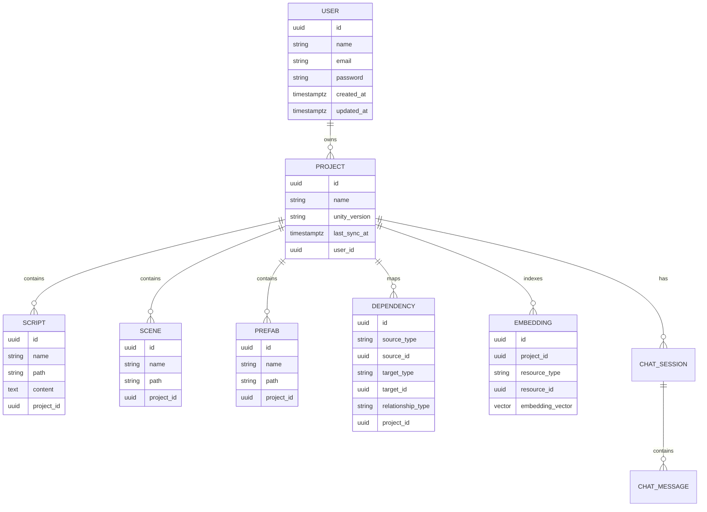
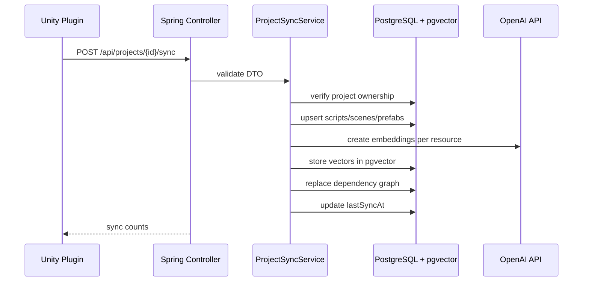
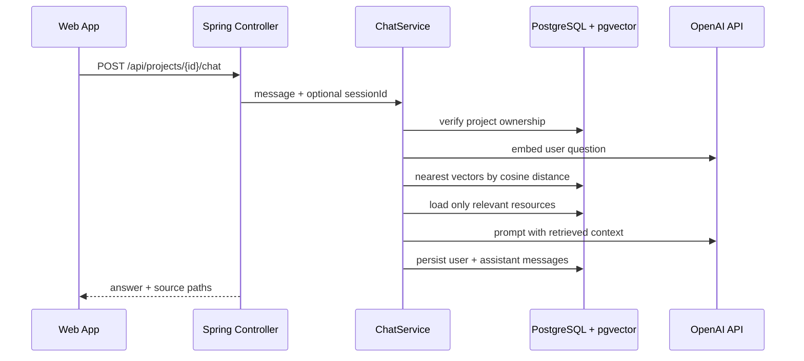

# UnityMind Backend

UnityMind is a simple monolithic SaaS backend for Unity developers. A Unity editor plugin syncs project metadata, the backend indexes scripts/scenes/prefabs/dependencies in PostgreSQL + pgvector, and chat uses retrieval-augmented generation instead of sending a whole Unity project to the model.

## Stack

- Java 21
- Spring Boot 3
- Spring Web, Spring Data JPA, Spring Security, Validation
- PostgreSQL with `pgvector`
- JWT + BCrypt
- OpenAI API integration isolated in `OpenAIClientService`
- Maven

## Run Locally

1. Start a pgvector-enabled PostgreSQL database:

```bash
docker compose up -d
```

The compose file maps Postgres to local port `5433` so it does not conflict with a normal local PostgreSQL install.

2. Set environment variables:

```bash
DB_URL=jdbc:postgresql://localhost:5433/unitymind
DB_USERNAME=postgres
DB_PASSWORD=postgres
JWT_SECRET=replace-with-at-least-32-byte-secret
OPENAI_API_KEY=sk-...
```

3. Start the app:

```bash
mvn spring-boot:run
```

## Folder Structure

```text
src/main/java/com/unitymind
  auth/        register, login, current user endpoints
  chat/        RAG chat sessions and messages
  common/      shared enums/constants
  embedding/   OpenAI embeddings and pgvector lookup
  exception/   global JSON error handling
  prefab/      prefab entity/repository/controller
  project/     project CRUD, sync, dependency graph
  scene/       scene entity/repository/controller
  script/      script entity/repository/controller
  search/      full-text + vector search
  security/    JWT filter/config/current user
  user/        user entity/repository/mapper
```

## Entity Relationship Diagram



## API Documentation

All endpoints except register/login require:

```http
Authorization: Bearer <jwt>
```

### Authentication

```http
POST /api/auth/register
POST /api/auth/login
POST /api/auth/logout
GET  /api/auth/me
```

### Projects

```http
GET    /api/projects
POST   /api/projects
GET    /api/projects/{id}
DELETE /api/projects/{id}
POST   /api/projects/{id}/sync
```

### Unity Resources

```http
GET /api/projects/{id}/scripts
GET /api/scripts/{scriptId}
GET /api/projects/{id}/scenes
GET /api/projects/{id}/prefabs
```

### Search

```http
GET /api/projects/{id}/search?q=PlayerController
```

Combines PostgreSQL full-text search with pgvector semantic search. If OpenAI is not configured, full-text search still returns results.

### Chat

```http
POST /api/projects/{id}/chat
GET  /api/projects/{id}/chat/sessions
GET  /api/chat/sessions/{id}
```

Chat request:

```json
{
  "sessionId": null,
  "message": "How does player movement work?"
}
```

## Sync Sequence



## Chat Sequence



## Notes

- The backend is intentionally monolithic: no queues, no microservices, no distributed orchestration.
- Ownership is validated through `ProjectService.getOwnedProject(...)` before project-scoped operations.
- Chat uses RAG and never sends the entire project to the model.
- `schema.sql` is the source for PostgreSQL + pgvector setup. In production, move it into Flyway or Liquibase migrations.
